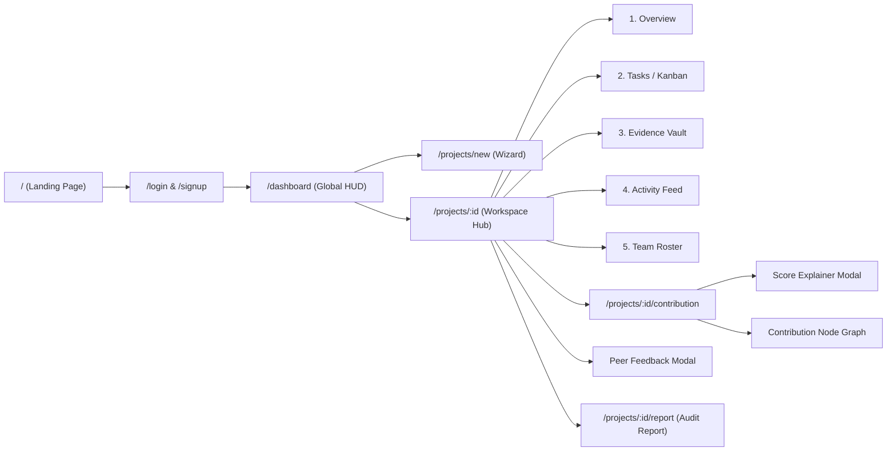
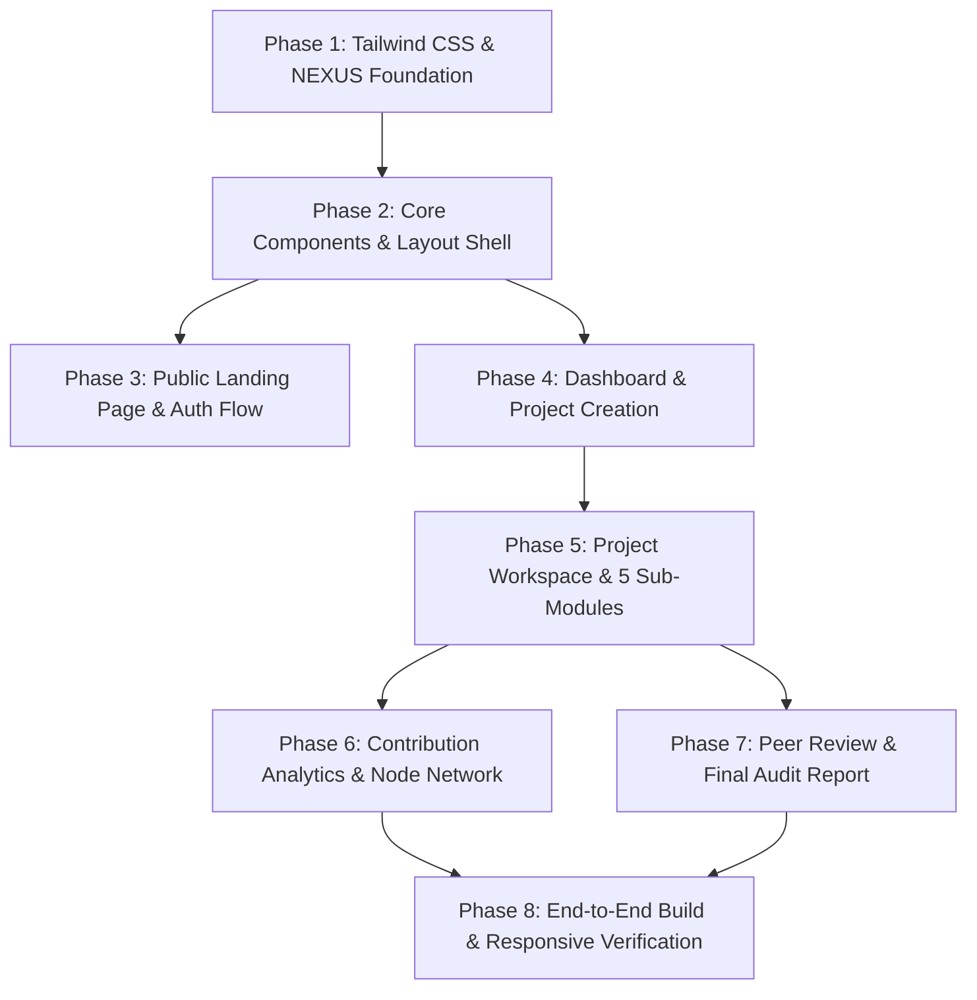

# FairShare Frontend Implementation Specification & NEXUS Blueprint

This document provides a comprehensive, implementation-ready frontend design and technical specification for **FairShare**, derived directly from [`idea.md`](idea.md), [`architecture.md`](architecture.md), [`backend.md`](backend.md), [`database.md`](database.md), and [`api.md`](api.md).

It establishes the **NEXUS Visual Experience**: a dark-futuristic, high-polish college hackathon and academic collaboration interface built with **React**, **Tailwind CSS**, and modern UI primitives.

---

## 1. Verified Framework & Toolchain

Inspection of the verified repository setup (`frontend/package.json`):
- **Runtime & Bundler:** Vite 8.3 (`"vite": "^8.3.0"`) with `@vitejs/plugin-react`
- **Core Framework:** React 19.2 (`"react": "^19.2.8"`, `"react-dom": "^19.2.8"`)
- **Routing:** React Router v7 (`"react-router-dom": "^7.18.4"`)
- **Icons:** Lucide React (`"lucide-react": "^1.48.0"`) — *already installed*
- **Visualizations:** Recharts (`"recharts": "^3.10.1"`) — *already installed*
- **HTTP Client:** Axios (`"axios": "^1.20.0"`) — *already installed*
- **Storage & Auth SDK:** Supabase JS (`"@supabase/supabase-js": "^2.117.2"`) — *already installed*
- **Linter & Formatter:** Oxlint (`"^1.81.0"`), Prettier (`"^3.9.9"`)

---

## 2. Evaluation of Free UI Tools & Stack Compatibility

| Library / Tool | Compatibility with React 19 & Tailwind | Value to FairShare | Recommendation & Role |
|---|---|---|---|
| **Tailwind CSS** (v4 via `@tailwindcss/vite` or v3.4) | High. Native Vite plugin support with CSS variables. | Provides foundational utility tokens, zero runtime overhead, responsive layout primitives, and rapid styling of dark futuristic themes. | **Adopt**. Foundation for all layout, spacing, and styling tokens. |
| **shadcn/ui** | Compatible with Tailwind; requires React 19 awareness for underlying Radix UI primitives. | Headless, copy-paste accessible component code owned directly in `src/components/ui`. No vendor runtime lock-in. | **Adopt for Functional Primitives**: Use for Dialog/Modal (`Modal.jsx`), Dropdown Menus, Tabs (`Tabs.jsx`), Tooltip, and Form controls. Custom-themed to NEXUS tokens. |
| **React Bits** | High. Standalone, zero-dependency or Motion-based copy-paste snippets. | High-impact visual accents fitting the college hackathon aesthetic (e.g., animated background grid, spotlight cards, magnetic action buttons, text decode/scrambler). | **Adopt Selectively**: Use for the Landing Page hero, interactive telemetry cards, and metric hover effects. Avoid excessive decorative clutter. |
| **Motion for React** (`motion` v12 / Framer Motion) | High. `motion` v12 officially supports React 19. | Declarative layout transitions (`layoutId` for workspace tabs and Kanban cards), modal entrance physics, and smooth numerical score tickers. | **Adopt**: Used for workspace tab switching, Kanban card transitions, and the Score Explainer modal. |
| **Lucide React** | Verified already installed (`^1.48.0`). Zero conflict with React 19. | Complete, lightweight icon suite for project statuses, task priority, file types (GitHub, Figma, PDF), and telemetry badges. | **Keep & Reuse**: Core icon provider across all screens. |

### How Selected Tools Work Together (Unified Architecture)
To prevent competing component or styling systems:
1. **Token Layer (Tailwind CSS):** Single source of truth for colors, typography, borders, and shadows defined in CSS variables and Tailwind classes.
2. **Behavioral & Accessibility Layer (shadcn/ui / Radix):** Accessible keyboard navigation, ARIA focus traps, and screen-reader semantics for modals, tabs, and form controls.
3. **Motion Layer (Motion for React):** Subtle micro-interactions, layout physics, and route transitions without modifying component structures.
4. **Hero Accents (React Bits):** Targeted visual polish on public and telemetry screens, fully themed using Tailwind utility classes.

---

## 3. Design System: NEXUS Visual Direction

The NEXUS aesthetic creates a dark, cinematic, technical interface designed for engineering students and hackathon participants who want genuine transparency and evidence-based grading.

### 3.1 Color Palette Tokens

| Token | Value | Semantic Role in FairShare |
|---|---|---|
| `bg-nexus-bg` | `#080B0D` | Obsidian void / application body background |
| `bg-nexus-surface` | `#11191B` | Primary card surfaces, sidebar, and container panels |
| `bg-nexus-surface-hover` | `#162225` | Interactive card hover, table row hover |
| `bg-nexus-elevated` | `#1A2629` | Modals, dropdowns, floating telemetry inspector |
| `text-nexus-lime` / `border-nexus-lime` | `#C5FF4A` | High-voltage accent: verified tasks, high scores (>80%), primary CTAs |
| `text-nexus-cyan` / `border-nexus-cyan` | `#52E8D1` | Data streams: PR links, live telemetry, node network edges |
| `text-nexus-amber` | `#F59E0B` | Warning: approaching deadlines (<48h), missing evidence alert |
| `text-nexus-crimson` | `#FF4D4D` | Urgent: overdue deliverables, critical priority tags |
| `text-nexus-text` | `#E7ECE8` | Primary readable headings and high-contrast labels |
| `text-nexus-muted` | `#9AA7A1` | Secondary descriptions, timestamps, metadata |
| `border-nexus-border` | `#1C2A29` | Subtle structural dividers and card perimeter outlines |
| `border-nexus-border-bright`| `#273E3B` | Active state borders and table headers |

### 3.2 Typography Tokens
- **Display & Headings:** `Space Grotesk` (uppercase tracking, technical cuts, weights 600/700).
- **Body & Controls:** `Inter` (neutral, crisp readability across desktop and mobile, weights 400/500/600).
- **Metrics, Telemetry & Code:** `JetBrains Mono` (tabular numbers for contribution %, timestamps, and commit hashes).

### 3.3 Surface Geometry & Technical Details
- **Card Framing:** Subtle 1px dark grey-green borders (`#1C2A29`) with optional technical corner tick marks (`nexus-corner-bracket`).
- **Telemetry Indicators:** Status LEDs with pulsing opacity animations for active project nodes.
- **Elevation:** Multi-layer dark shadows (`0 8px 32px -4px rgba(0, 0, 0, 0.75)`) instead of heavy white blur glassmorphism.

---

## 4. User Workflows & Screen Breakdown

All screens correspond strictly to verified features in [`idea.md`](idea.md), [`architecture.md`](architecture.md), and [`api.md`](api.md).



### 4.1 Landing Page (`/` — `src/pages/LandingPage.jsx`)
- **UI Tools Applied:**
  - `React Bits`: Animated background grid canvas, Spotlight effect on interactive demo cards, Text scramble / decode hero subtitle effect.
  - `Motion for React`: Staggered entrance animations for feature cards, smooth numerical score interpolation on the demo slider.
  - `shadcn/ui`: Accessible Slider control for live 5-factor weighting simulation, Button primitive with custom NEXUS styling.
  - `Lucide React`: `ShieldCheck`, `TrendingUp`, `GitPullRequest`, `Award`, `ArrowRight`, `Sliders` icons.
- **Hero Section:**
  - Headline: *"Making Every Contribution Count"*
  - Subtitle: *"Transparent, evidence-based project management for student groups. Say goodbye to unequal group project marks."*
  - CTAs: `[Launch Workspace Demo]` and `[Enlist Team]`
  - Real-time telemetry ticker showing active metrics (tasks verified, PRs linked, peer reviews recorded).
- **Problem vs. Solution Matrix:**
  - Side-by-side comparison: *Traditional Group Projects (Subjective grading, free-rider problem, no accountability)* vs. *FairShare (Transparent 5-factor scoring, verifiable artifacts, anonymous peer feedback)*.
- **Interactive Score Simulator Demo Widget:**
  - Interactive slider (`shadcn/ui` Slider) allowing prospective users to test the 5-factor weighting algorithm and see live score adjustments animated via `Motion for React`.
- **The 4-Step Student Workflow:**
  1. *Create & Assign* (Define prioritized milestones)
  2. *Submit Work Evidence* (Link GitHub PRs, Figma, docs)
  3. *Continuous Activity Tracking* (Immutable project event stream)
  4. *Fair Score & Formal Report* (Objective 5-factor calculation)

### 4.2 Authentication Views (`/login` & `/signup`)
- **UI Tools Applied:**
  - `shadcn/ui`: Accessible `Input`, `Label`, `Button`, and `Card` primitives styled with dark green-grey borders and obsidian backgrounds.
  - `Motion for React`: Animated tab slide transition (`layoutId="auth-tab"`) between Login and Register views.
  - `Lucide React`: `Terminal`, `Lock`, `Mail`, `User`, `Building`, `ArrowRight`, `KeyRound` icons.
- **Login (`LoginPage.jsx`):**
  - Student email & password fields.
  - JWT session token storage in `localStorage` (`fairshare_token`).
  - Terminal-inspired login panel with fast-demo autofill option for instant evaluation.
- **Registration (`SignupPage.jsx`):**
  - Full Name, Student Email, College/University name, Password.
  - Automatic reconciliation of pending project invitations matching the user's email upon registration (as implemented in `auth_service.py`).

### 4.3 Global Dashboard (`/dashboard` — `src/pages/DashboardPage.jsx`)
- **UI Tools Applied:**
  - `shadcn/ui`: Accessible `Card`, `Progress` bar primitives, and `Tooltip` for team member avatars.
  - `React Bits`: Spotlight card hover effect revealing cyan border glow on active projects.
  - `Motion for React`: Fade-in stagger for project cards on mount.
  - `Lucide React`: `LayoutDashboard`, `Clock`, `Calendar`, `CheckCircle2`, `FolderPlus`, `ChevronRight`, `AlertCircle` icons.
- **HUD Header:** Welcome greeting, university affiliation, active project count, completed deliverables count.
- **Active Projects Grid (`ProjectCard.jsx`):**
  - Project Title & Category (e.g. *Smart Water Management System — IoT & Full-Stack*).
  - Deadline countdown pill (e.g., `14d remaining`).
  - Progress bar (`Completed Tasks / Total Tasks`).
  - Team member avatars with contribution badges.
  - Quick action links: `[Open Workspace]` and `[Contribution Analytics]`.
- **Upcoming Deadlines Panel (`UpcomingDeadlines.jsx`):**
  - User-assigned deliverables due within 72 hours, sorted by priority (`High`, `Medium`, `Low`).
- **Global Activity Terminal (`RecentActivityFeed.jsx`):**
  - Chronological live feed of submissions across all enrolled projects.

### 4.4 Project Creation Flow (`/projects/new` — `src/pages/CreateProjectPage.jsx`)
- **UI Tools Applied:**
  - `shadcn/ui`: `Dialog` modal container, `Input`, `Textarea`, `Select`, `Button` form primitives.
  - `Motion for React`: Smooth step-by-step horizontal slide animation between wizard stages (Step 1 → Step 2 → Step 3).
  - `Lucide React`: `UserPlus`, `Trash2`, `Calendar`, `Sparkles`, `Check` icons.
- **Step 1: Project Specifications:**
  - Project Name, Description, Category (Academic, Hackathon, Capstone), Start Date, Final Deadline.
- **Step 2: Team Members & Role Matrix:**
  - Dynamic roster input (Student Email + Assigned Role, e.g. `Frontend Lead`, `Backend Dev`).
  - Identifies the creator as Project Lead.
- **Step 3: Review & Initialize:**
  - Summary review and `[Create Workspace]` trigger (calls `POST /api/projects`).

### 4.5 Project Workspace (`/projects/:id` — `src/pages/ProjectWorkspacePage.jsx`)
- **UI Tools Applied:**
  - `shadcn/ui`: `Tabs`, `TabsList`, `TabsTrigger`, `TabsContent` primitives for the 5 sub-modules; `Dialog` for Create Task & Submit Evidence modals; `DropdownMenu` for task status workflows.
  - `Motion for React`: `layoutId="active-workspace-tab"` animating the sliding active pill; card dragging and layout animation on task transitions.
  - `React Bits`: Micro-spotlight on evidence deliverables cards.
  - `Lucide React`: `Columns`, `List`, `Paperclip`, `ExternalLink`, `GitPullRequest`, `Figma`, `FileText`, `CheckCircle2`, `AlertTriangle`, `Plus`, `Users`, `Activity` icons.
Organized into 5 dedicated tabbed sub-modules:
- **Tab 1: Overview:**
  - Project telemetry header: Overall completion rate, days remaining, active team count.
  - Team member workload cards: Assigned tasks, completed tasks, evidence submission rates.
  - Peer review window banner: *Unlocked 3 days before deadline.*
- **Tab 2: Task Management (`TaskBoard.jsx`):**
  - View Toggle: Cyber-Kanban Board (`To Do`, `In Progress`, `Completed`) and List/Table View.
  - Task Card (`TaskCard.jsx`):
    - Title, Assigned Member avatar, Deadline indicator (green/amber/red).
    - Priority pill (`High`, `Medium`, `Low`).
    - **Evidence Status Indicator:** Green checkmark if verified artifact attached; amber alert *"Evidence Missing"* if completed without proof.
    - Quick actions: `[Change Status]`, `[Attach Evidence]`, `[View Details]`.
  - Create Task Modal (`CreateTaskModal.jsx`): Title, description, priority, assignee, deadline (calls `POST /api/projects/<id>/tasks`).
- **Tab 3: Work Evidence Vault (`EvidenceVault.jsx`):**
  - Searchable, filterable repository of all deliverables submitted to the project.
  - Supports both external URLs (GitHub PRs, Figma designs, Google Docs) and file uploads (PDFs, schematics uploaded via `POST /api/upload`).
  - Filter by Member, Deliverable Type, and Verification status.
  - Proof inspector modal (`shadcn/ui` Dialog) with live previews and direct links.
- **Tab 4: Activity Feed (`ActivityTimeline.jsx`):**
  - Immutable chronological audit trail of project operations fetched via `GET /api/projects/<id>/activity`.
  - Clear visual icons for task status changes, evidence submissions, and member joins.
- **Tab 5: Team Roster (`TeamDirectory.jsx`):**
  - List of team members, roles, contact info, task completion counts, and invitation status (`Active` vs. `Pending Invite`).
  - Modal to invite new teammates (calls `POST /api/projects/<id>/members`).

### 4.6 Contribution Dashboard (`/projects/:id/contribution` — `src/pages/ContributionPage.jsx`)
- **UI Tools Applied:**
  - `shadcn/ui`: `Progress` bar primitives for each factor, `Dialog` for the Score Explainer modal, `Tooltip` for mathematical formula breakdowns.
  - `React Bits`: Spotlight effect on the primary 82% Contribution Score HUD tile.
  - `Motion for React`: Animated score ticker count-up (0% → 82%), animated edge pulse along topological connections in the Node Graph.
  - `Lucide React`: `BarChart3`, `Award`, `HelpCircle`, `TrendingUp`, `Users`, `CheckCircle`, `ExternalLink` icons.
- **Primary Metric HUD:**
  - Overall Contribution Score (e.g. `82%`) with status rank (`Exemplary Contributor`).
  - Deliverables Finalized (`18 / 20 Tasks — 90%`).
  - On-Time Delivery Rate (`85%`).
  - Verified Evidence Artifacts (`16 Submissions`).
  - Teammate Evaluation Average (`3.75 / 5.0`).
- **5-Factor Contribution Breakdown (`ScoreFactorBreakdown.jsx`):**
  - Mathematical breakdown with weights:
    - **Task Completion (30% weight):** `90%` → `27.0%`
    - **Timeliness (20% weight):** `85%` → `17.0%`
    - **Work Evidence (20% weight):** `80%` → `16.0%`
    - **Peer Feedback (20% weight):** `75%` → `15.0%`
    - **Participation (10% weight):** `70%` → `7.0%`
    - **Total Combined:** **82%**
- **Score Explainer Modal (`ScoreExplainerModal.jsx`):**
  - Built with `shadcn/ui` Dialog and accessible ARIA attributes.
  - Opens on clicking any factor or the *"How is this calculated?"* button.
  - Explains the exact formula and reason: e.g., *"Why did I get 85% in Timeliness? You completed 17 of 20 tasks on or before the server deadline timestamp. 3 tasks were finalized after the deadline."*
  - Includes academic fairness and anti-gaming disclaimers.
- **Team Contribution Comparison (`TeamComparisonChart.jsx`):**
  - Horizontal Recharts bar visualization comparing teammates respectfully without toxic leaderboard gamification.
- **Weekly Progression Trends (`ContributionTrendChart.jsx`):**
  - Recharts multi-line chart demonstrating consistent weekly progress over last-minute rushing.
- **Distinctive Visual Feature — NEXUS Contribution Node Graph (`ContributionNodeNetwork.jsx`):**
  - Interactive connected-topology SVG visualization mapping:
    - Central Project Hub → Team Member Nodes → Deliverable Task Nodes → Verified Evidence Leaf Nodes.
    - Animated edge pulses powered by `Motion for React`.
    - Interactive hover telemetry showing member role, task details, and artifact URLs.

### 4.7 Peer Feedback Modal (`src/components/feedback/PeerFeedbackModal.jsx`)
- **UI Tools Applied:**
  - `shadcn/ui`: `Dialog` modal with focus trap, `Textarea` for constructive notes, `Button` for rating submissions.
  - `Motion for React`: Animated transitions between teammate evaluation cards.
  - `Lucide React`: `Star`, `UserCheck`, `Lock`, `ShieldAlert`, `Check` icons.
- Anonymous peer evaluation form per teammate across the 6 dimensions defined in `idea.md`:
  1. **Participation:** Active involvement in discussions and planning (1–5).
  2. **Responsibility:** Took ownership of assigned deliverables (1–5).
  3. **Quality of Work:** Standard and thoroughness of output (1–5).
  4. **Collaboration:** Willingness to support and work with others (1–5).
  5. **Communication:** Prompt updates and clear messaging (1–5).
  6. **Timeliness:** Respected internal commitments and dates (1–5).
- Constructive qualitative feedback text box.
- Enforces anti-self-review safeguards (`reviewer_id != reviewee_id`).
- Strictly sanitizes results so members only view anonymized category averages.

### 4.8 Final Audit Report (`/projects/:id/report` — `src/pages/FinalReportPage.jsx`)
- **UI Tools Applied:**
  - `shadcn/ui`: `Table`, `Badge`, `Separator` primitives.
  - `Lucide React`: `Printer`, `Download`, `ShieldCheck`, `CheckSquare`, `ExternalLink`, `FileSpreadsheet` icons.
- Print-friendly and downloadable project evaluation certificate:
  - Project Title, Course/Hackathon, Timeline, Team Roster.
  - Individual Contribution Summary Table with scores, completed tasks, and timeliness %.
  - Complete Evidence Audit Ledger (clickable links to verified PRs and documents).
  - Formal academic fairness methodology statement.
  - `[Download PDF / Print]` action formatted with `@media print` styling (clean monochrome printable layout).

---

## 5. Reusable Component Strategy & Directory Layout

Every component is architected with a dedicated responsibility and explicitly mapped to the 4 UI tools:
- **`[shadcn/ui]`**: Accessible dialogs, tabs, progress bars, dropdowns, and form primitives.
- **`[React Bits]`**: Distinctive visual accents, background grid, spotlight cards, text decode.
- **`[Motion for React]`**: Tab sliding layout indicators (`layoutId`), modal entrance physics, and count-up tickers.
- **`[Lucide React]`**: Scalable interface icons.

```text
frontend/src/
├── main.jsx                       # Application entry point
├── App.jsx                        # React Router v7 routes & layout wrappers [Motion for React]
├── index.css                      # Tailwind imports, custom font faces, & NEXUS tokens
├── assets/                        # Static logos and graphic assets
├── context/
│   ├── AuthContext.jsx            # Current student, token storage, login/logout
│   └── ProjectContext.jsx         # Active project state, tasks cache, active tab
├── services/
│   ├── apiClient.js               # Axios instance with Bearer interceptors & mock fallbacks
│   └── mockData.js                # High-fidelity prototype datasets (SAMPLE_PROJECT)
├── components/
│   ├── common/
│   │   ├── Navbar.jsx             # [Lucide React + Motion for React] Top bar with telemetry LED, nav links, & user badge
│   │   ├── MetricCard.jsx         # [React Bits + Lucide React] Technical HUD metric widget with corner brackets
│   │   ├── Modal.jsx              # [shadcn/ui + Motion for React] Accessible modal dialog (Escape key, backdrop blur)
│   │   ├── Badge.jsx              # [shadcn/ui] Status pill (lime, cyan, amber, crimson)
│   │   └── Button.jsx             # [shadcn/ui + React Bits] Cyber-styled primary, secondary, and ghost buttons
│   ├── dashboard/
│   │   ├── ProjectCard.jsx        # [React Bits + shadcn/ui + Lucide React] Project HUD card with countdown & progress
│   │   ├── UpcomingDeadlines.jsx  # [shadcn/ui + Lucide React] 72-hour deliverable countdown panel
│   │   └── ActivityFeed.jsx       # [Lucide React + Motion for React] Global event stream
│   ├── workspace/
│   │   ├── TaskBoard.jsx          # [shadcn/ui Tabs + Motion for React] Kanban & list toggle
│   │   ├── TaskCard.jsx           # [Motion for React + Lucide React] Task item with priority & evidence status
│   │   ├── CreateTaskModal.jsx    # [shadcn/ui Dialog/Form + Lucide React] Deliverable authoring form
│   │   ├── SubmitEvidenceModal.jsx# [shadcn/ui Dialog/Form + Lucide React] File upload & external URL attachment
│   │   ├── EvidenceVault.jsx      # [React Bits + shadcn/ui + Lucide React] Filterable deliverable repository
│   │   ├── ActivityTimeline.jsx   # [Lucide React + Motion for React] Chronological immutable event stream
│   │   └── TeamDirectory.jsx      # [shadcn/ui + Lucide React] Teammates, roles, and invitation modal
│   ├── contribution/
│   │   ├── ContributionNodeNetwork.jsx # [Motion for React + Lucide React] Distinctive connected topology graph
│   │   ├── ScoreFactorBreakdown.jsx    # [shadcn/ui Progress + Motion for React] 5-factor mathematical progress bars
│   │   ├── ScoreExplainerModal.jsx     # [shadcn/ui Dialog + Lucide React] "Why did I get this score?" breakdown
│   │   ├── TeamComparisonChart.jsx     # [Recharts + Lucide React] Recharts horizontal comparison
│   │   └── ContributionTrendChart.jsx  # [Recharts + Lucide React] Recharts weekly progression
│   └── feedback/
│       └── PeerFeedbackModal.jsx       # [shadcn/ui Dialog/Textarea + Lucide React + Motion for React] 6-dimension teammate rating modal
└── pages/
    ├── LandingPage.jsx            # [React Bits + shadcn/ui + Motion for React + Lucide React] Public product showcase & score simulator
    ├── LoginPage.jsx              # [shadcn/ui + Lucide React + Motion for React] Terminal authentication
    ├── SignupPage.jsx             # [shadcn/ui + Lucide React + Motion for React] Student onboarding
    ├── DashboardPage.jsx          # [React Bits + shadcn/ui + Lucide React] Multi-project overview HUD
    ├── CreateProjectPage.jsx      # [shadcn/ui + Motion for React + Lucide React] 3-step project wizard
    ├── ProjectWorkspacePage.jsx   # [shadcn/ui Tabs + Motion for React + Lucide React] Tabbed operations workspace
    ├── ContributionPage.jsx       # [React Bits + Motion for React + shadcn/ui + Lucide React] Analytics, 5-factor scores & node graph
    └── FinalReportPage.jsx        # [shadcn/ui Table + Lucide React] Printable audit document
```

---

## 6. Integration with Backend APIs & Authentication

### 6.1 Authentication Integration
- Endpoints: `POST /api/auth/register`, `POST /api/auth/login`, `GET /api/auth/me`.
- Token Injection: Axios request interceptor attaches `Authorization: Bearer <token>` from `localStorage.getItem('fairshare_token')`.
- Fast Demo Mode: If the backend is offline or during prototype evaluation, `apiClient.js` provides automatic fallback to `mockData.js`, ensuring all navigation and interactive components remain functional.

### 6.2 Data Contracts & Route Mapping

| Frontend View / Component | Backend API Endpoint | HTTP Method | Payload / Response |
|---|---|---|---|
| `DashboardPage` | `/api/projects` | `GET` | List of active enrolled projects |
| `CreateProjectPage` | `/api/projects` | `POST` | `{ name, description, category, deadline, members }` |
| `ProjectWorkspacePage` | `/api/projects/<id>` | `GET` | Project details, roster, pending invites |
| `TaskBoard` | `/api/projects/<id>/tasks` | `GET`, `POST` | List of tasks / Create deliverable |
| `TaskCard` (Status Toggle) | `/api/tasks/<id>/status` | `PATCH` | `{ status: "Completed" }` (captures server timestamp) |
| `SubmitEvidenceModal` | `/api/upload` (File) | `POST` | Multipart `file` + `project_id` → storage URL |
| `SubmitEvidenceModal` | `/api/tasks/<id>/evidence` | `POST` | `{ type, title, url }` → attaches proof to task |
| `ContributionPage` | `/api/projects/<id>/contribution/<user_id>` | `GET` | 5-factor mathematical score breakdown |
| `ContributionPage` | `/api/projects/<id>/team-comparison` | `GET` | Teammate comparative scores |
| `ContributionPage` | `/api/projects/<id>/trends` | `GET` | Weekly snapshot progression array |
| `PeerFeedbackModal` | `/api/projects/<id>/feedback` | `POST` | `{ reviewee_id, ratings: { participation, ... } }` |
| `FinalReportPage` | `/api/projects/<id>/report` | `GET` | Complete project audit ledger |

---

## 7. Responsive Behavior & Accessibility Strategy

### 7.1 Viewport Breakpoints
- **Mobile (<768px):** Single-column stacked layouts, collapsed hamburger drawer navigation, swipeable or single-column Kanban, touch targets >= 44px.
- **Tablet (768px – 1023px):** Two-column adaptive grid, side-by-side metric cards, responsive Recharts containers.
- **Desktop (>=1024px):** Full three-column Kanban board, multi-metric HUD, expanded Contribution Node Network, and side-by-side data visualizations.

### 7.2 Accessibility Standards (WCAG 2.1 AA)
- **High Contrast Ratios:** Text `#E7ECE8` on `#080B0D` achieves a 14.8:1 contrast ratio. Accent `#C5FF4A` on `#080B0D` achieves a 12.2:1 contrast ratio.
- **Keyboard Navigation & Focus Management:** Accessible modal dialogs trap focus upon opening, close on `Escape`, and return focus to the trigger element.
- **Reduced Motion:** Full support for `@media (prefers-reduced-motion: reduce)` by disabling all pulsating LED animations, card scale transforms, and particle movements.

---

## 8. Implementation Phases, Dependencies, & Verification Criteria



### Phase 1: Tailwind CSS & NEXUS Design Foundation
- **Tools Applied:** `Tailwind CSS`, Google Fonts (`Space Grotesk`, `Inter`, `JetBrains Mono`).
- **Tasks:** Install and configure Tailwind CSS in `frontend/`, configure Google Fonts in `index.html`, and set up design tokens in `index.css`.
- **Verification:** Run `npm run build` or `vite dev` to verify token compilation with zero syntax errors.

### Phase 2: Core Infrastructure & Layout Shell
- **Tools Applied:** `shadcn/ui` (Modal/Dialog, Badge, Button), `Lucide React` (HUD icons, status LEDs), `Motion for React` (Navbar mobile drawer & layout physics), `React Bits` (Technical metric card corner framing).
- **Tasks:** Create `src/services/apiClient.js`, `src/services/mockData.js`, `src/context/AuthContext.jsx`, `Navbar.jsx`, `Modal.jsx`, `MetricCard.jsx`, and `Badge.jsx`.
- **Verification:** Verify JWT token persistence in `localStorage` and responsive navigation drawer on mobile viewports.

### Phase 3: Public Landing Page & Terminal Auth
- **Tools Applied:** `React Bits` (Animated background grid, spotlight card, text decode effect), `shadcn/ui` (Weighting slider, Auth form inputs & cards), `Motion for React` (Score calculation animation, auth tab slider), `Lucide React` (Feature & terminal icons).
- **Tasks:** Implement `LandingPage.jsx` with the interactive 5-factor contribution score simulator and problem comparison, plus `LoginPage.jsx` and `SignupPage.jsx`.
- **Verification:** Test interactive score slider; verify seamless login transition to `/dashboard`.

### Phase 4: Global Dashboard & Project Creation
- **Tools Applied:** `shadcn/ui` (Project card, Progress bar, Tooltip, Creation dialog), `React Bits` (Spotlight glow on active projects), `Motion for React` (Card entrance stagger, stepper slide), `Lucide React` (Calendar, Clock, CheckCircle2, FolderPlus).
- **Tasks:** Implement `DashboardPage.jsx`, `ProjectCard.jsx`, `UpcomingDeadlines.jsx`, and the 3-step `CreateProjectPage.jsx` wizard.
- **Verification:** Verify project card countdown timers, progress calculation, and project creation submission.

### Phase 5: Project Workspace Hub (5 Sub-Modules)
- **Tools Applied:** `shadcn/ui` (Tabs, TabsList, TabsTrigger for 5 views; Dialog for Create Task & Submit Evidence; DropdownMenu for status toggle), `Motion for React` (`layoutId` active tab pill, Kanban drag/transition animations), `Lucide React` (Kanban columns, paperclip, external links, GitHub, Figma, PDF), `React Bits` (Evidence card spotlight).
- **Tasks:** Build `ProjectWorkspacePage.jsx` with tab switcher:
  1. *Overview* (telemetry & workload cards)
  2. *Tasks* (`TaskBoard.jsx` with Kanban drag/status advance and `CreateTaskModal.jsx`)
  3. *Evidence Vault* (`EvidenceVault.jsx` and `SubmitEvidenceModal.jsx`)
  4. *Activity Feed* (`ActivityTimeline.jsx`)
  5. *Team Roster* (`TeamDirectory.jsx`)
- **Verification:** Verify status transitions update completion timestamps, and evidence attachments update the evidence indicator on task cards.

### Phase 6: Contribution Analytics & Distinctive Node Network
- **Tools Applied:** `shadcn/ui` (Progress bars for 5 factors, Dialog for Score Explainer modal, Tooltip), `Motion for React` (Animated score count-up, topological edge pulse in the Node Graph), `React Bits` (Score HUD spotlight tile), `Lucide React` (Award, HelpCircle, TrendingUp, BarChart3).
- **Tasks:** Implement `ContributionPage.jsx`, Recharts team horizontal comparison, 4-week progression line graph, `ScoreExplainerModal.jsx`, and the **NEXUS Contribution Node Graph** (`ContributionNodeNetwork.jsx`).
- **Verification:** Verify interactive hover inspection on the node network and mathematical accuracy in the 5-factor score breakdown.

### Phase 7: Peer Review Modal & Final Audit Report
- **Tools Applied:** `shadcn/ui` (Dialog modal with focus trap, Rating controls, Textarea, Table, Badge), `Motion for React` (Teammate card transitions), `Lucide React` (Star ratings, ShieldCheck, Printer, Download).
- **Tasks:** Implement `PeerFeedbackModal.jsx` (6-dimension rating form with anti-self-review checks) and `FinalReportPage.jsx` with print stylesheet (`@media print`).
- **Verification:** Test peer evaluation submission and verify `window.print()` triggers a clean, professional audit document.

### Phase 8: End-to-End Build & Responsive Browser Verification
- **Tools Applied:** All 4 integrated tools (`shadcn/ui`, `React Bits`, `Motion for React`, `Lucide React`) tested under responsive viewports.
- **Tasks:** Run production build check (`npm run build`) and inspect rendered views across desktop (1440px), tablet (768px), and mobile (375px).
- **Verification:** Ensure zero console errors, zero horizontal overflow, and fully responsive touch targets.

---

## 9. Specification Gaps & Unresolved Technical Decisions

During inspection of the repository specifications, the following gaps and decisions were identified:

1. **Direct Storage Upload vs. API Proxy (`/api/upload`):**
   - *Issue:* `architecture.md` mentions `@supabase/supabase-js` direct client storage, while `api.md` defines `POST /api/upload` multipart through Flask.
   - *Resolution:* Use the Flask `POST /api/upload` endpoint as primary so that file size restrictions, allowed extensions (`pdf`, `png`, `jpg`, `zip`), and project membership authorization are strictly enforced by the backend before persistence.
2. **Real-time Event Synchronization vs. SWR/Polling:**
   - *Issue:* `architecture.md` mentions Supabase Postgres real-time events, but task status transitions and activity logs are mutated through Flask REST endpoints.
   - *Resolution:* Implement optimistic state updates in `ProjectContext` combined with automatic refetching upon tab changes and modal dismissals to avoid unnecessary persistent WebSocket overhead during the prototype.
3. **Peer Feedback Lock Timers:**
   - *Issue:* `frontend.md` specifies peer feedback unlocks 3 days before project deadline, but the backend allows feedback at any time during project lifecycle.
   - *Resolution:* The frontend will display the countdown banner and mark the feedback button with a helpful notice (`Opens 3 days before deadline`), but will allow review submission if requested to facilitate demo evaluation.
4. **Tailwind Version Compatibility:**
   - *Issue:* Tailwind CSS v4 is available, but some shadcn/ui and Radix primitives have simpler setup in Tailwind v3.4 or require `@tailwindcss/vite` configuration in React 19.
   - *Resolution:* Configure Tailwind CSS with the official `@tailwindcss/vite` plugin or Tailwind v3.4 with standard PostCSS, ensuring CSS variables cleanly map to all NEXUS tokens.
